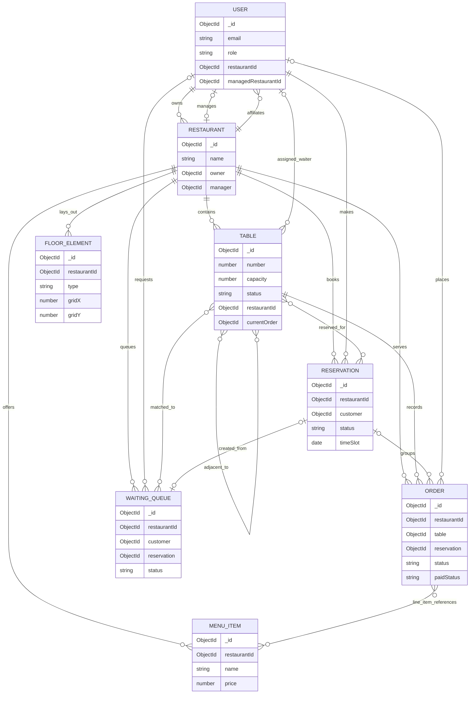

# Project data model overview

This describes the eight Mongoose models in `backend/models` and the behavior wired through the backend routes, controllers, and services. It is a description of the code, not a statement that every rule is guaranteed by MongoDB. Unless stated otherwise, a field with no schema default has no default (it is normally absent/`undefined` when omitted). All models also receive Mongoose's implicit `_id` and `__v` fields and `_id` index; the schemas do not enable automatic `createdAt`/`updatedAt` timestamps.

## 1. COLLECTION INVENTORY

### Restaurant

**Purpose:** Stores a restaurant's public details, ownership/manager links, and reservation-capacity settings.

| Field | Type | Required? | Default | Meaning / constraints |
|---|---|---:|---|---|
| `name` | String | Yes | — | Restaurant name. |
| `owner` | ObjectId -> User | Yes | — | User considered the restaurant owner. |
| `manager` | ObjectId -> User | No | `null` | The assigned manager, if any. |
| `defaultSeatingDurationMinutes` | Number | No | `60` | Default reservation duration; schema range is 15–240. |
| `maxPartySizeOverride` | Number | No | `null` | Optional configured party-size figure; schema minimum is 1. The service treats it as a floor beneath computed capacity, not as a cap. |
| `address` | String | No | — | Public restaurant address. |
| `phone` | String | No | — | Optional phone; accepts blank/null or digits, spaces, `+`, `-`, parentheses, with at least seven digits when nonblank. |
| `cuisine` | Array of String | No | `[]` | Cuisine labels used for public filtering/display. |
| `createdAt` | Date | No | `Date.now` | Document creation time. |

**Indexes:** No schema-defined indexes beyond implicit `_id`.

**Hooks, statics, methods:** No schema hooks/statics/methods. Phone format is enforced by a schema validator; restaurant registration/settings also validate relevant input in controllers.

### User

**Purpose:** Stores login credentials and a person's role and optional restaurant affiliation.

| Field | Type | Required? | Default | Meaning / constraints |
|---|---|---:|---|---|
| `name` | String | Yes | — | Display name. |
| `email` | String | Yes | — | Login email; lowercased by Mongoose and unique. |
| `password` | String | Yes | — | Password hash after save; minimum input length 6. |
| `mustChangePassword` | Boolean | No | `false` | Set for newly-created staff accounts and cleared after password change. |
| `role` | String | No | `"customer"` | One of `customer`, `owner`, `waiter`, `chef`, `cashier`, `host`, `manager`. |
| `phone` | String | No | — | Optional contact value; no schema format validator. |
| `restaurantId` | ObjectId -> Restaurant | Conditionally required | — | Restaurant affiliation. Required by schema for `waiter`, `chef`, `cashier`, `host`, and `manager`; not required for `customer` or `owner`. |
| `managedRestaurantId` | ObjectId -> Restaurant | No | `null` | Additional manager-to-restaurant link maintained when assigning/removing managers. |
| `createdAt` | Date | No | `Date.now` | Document creation time. |

**Indexes:**
- Unique `email` index (`unique: true`): prevents duplicate email values.
- No other schema-defined indexes.

**Hooks, statics, methods:**
- `pre("save")`: when `password` is modified, hashes it with bcrypt using a generated cost-10 salt. Save errors are rethrown.
- `comparePassword(candidatePassword)`: bcrypt-compares a candidate with the stored hash and returns the result; errors are rethrown.

### Table

**Purpose:** Represents a physical restaurant table, its floor-plan position, operational state, and links used for seating and table combinations.

| Field | Type | Required? | Default | Meaning / constraints |
|---|---|---:|---|---|
| `number` | Number | Yes | — | Restaurant-facing table number. |
| `capacity` | Number | Yes | — | Number of seats; no schema minimum is declared. |
| `status` | String | No | `"available"` | One of `available`, `reserved`, `occupied`, `cleaning`. |
| `currentOrder` | ObjectId -> Order | No | `null` | Order currently associated with this table. |
| `combinedGroupId` | ObjectId (no `ref`) | No | `null` | Shared identifier used to group tables combined for a walk-in/order. |
| `restaurantId` | ObjectId -> Restaurant | Yes | — | Owning restaurant. |
| `assignedWaiter` | ObjectId -> User | No | `null` | Waiter assigned to serve this table. |
| `gridX` | Number | Yes | — | Non-negative floor-plan grid coordinate, checked by table/floor-layout controllers (not by schema). |
| `gridY` | Number | Yes | — | Non-negative floor-plan grid coordinate, checked by table/floor-layout controllers (not by schema). |
| `shape` | String | No | `"square"` | One of `square`, `round`, `rect`. |
| `combinable` | Boolean | No | `false` | Whether table-combination logic may include this table. |
| `adjacentTo` | Array of ObjectId -> Table | No | `[]` | Tables considered adjacent for combinations. |
| `createdAt` | Date | No | `Date.now` | Document creation time. |

**Indexes:**
- Unique compound `{ restaurantId: 1, number: 1 }`: table numbers cannot repeat within one restaurant.
- No other schema-defined indexes.

**Hooks, statics, methods:** None. The `tableAdjacencyService` updates the inverse adjacency links and validates same-restaurant references when controllers change adjacency.

### Reservation

**Purpose:** Records a customer's time-bounded booking of one or more tables and its confirmation/seating lifecycle.

| Field | Type | Required? | Default | Meaning / constraints |
|---|---|---:|---|---|
| `restaurantId` | ObjectId -> Restaurant | Yes | — | Restaurant at which the booking is made. |
| `customer` | ObjectId -> User | Yes | — | Reserving customer. |
| `tables` | Array of ObjectId -> Table | Yes | Mongoose array default `[]` | Selected tables; custom validator requires at least one. |
| `partySize` | Number | Yes | — | Number of guests; minimum 1. |
| `timeSlot` | Date | Yes | — | Reservation start time. |
| `durationMinutes` | Number | Yes | — | Reservation duration; no schema minimum is declared. |
| `status` | String | No | `"locked"` | One of `locked`, `confirmed`, `seated`, `completed`, `cancelled`, `no_show`. |
| `requiresApproval` | Boolean | No | `false` | Whether a multi-table booking awaits staff approval. |
| `lockExpiresAt` | Date | No | `null` | Expiry time for the temporary booking lock. |
| `lockedTableSlots` | Array of String | No | `[]` | 15-minute time-bucket keys used by a unique partial index to prevent confirmed/seated reservations from claiming the same table bucket. |
| `createdAt` | Date | No | `Date.now` | Document creation time. |

**Indexes:**
- Unique multikey `{ lockedTableSlots: 1 }` with partial filter `{ lockedTableSlots: { $exists: true, $ne: [] } }`: no two indexed reservation documents may contain the same nonempty slot key. A slot key is `<tableId>_<bucketStartMs>`.
- There are no schema indexes directly on `restaurantId`, `customer`, `tables`, `status`, or `timeSlot`.

**Hooks, statics, methods:**
- `getLockedTableSlots({ tables, timeSlot, durationMinutes })`: creates the set of 15-minute UTC-epoch-aligned buckets intersected by each table's reservation interval. It returns `[]` for no tables and throws if duration is not finite/positive. The end boundary is exclusive (calculated using `endMs - 1`).
- `pre("save")`: clears `lockedTableSlots` unless status is `confirmed` or `seated`. It does not populate the field for those statuses and does not itself enforce that the array is nonempty.

### Order

**Purpose:** Stores a table order, its item snapshots, workflow status, bill amounts, and payment information.

| Field | Type | Required? | Default | Meaning / constraints |
|---|---|---:|---|---|
| `table` | ObjectId -> Table | Yes | — | Table recorded for the order. |
| `restaurantId` | ObjectId -> Restaurant | Yes | — | Restaurant that owns the order; also stored directly rather than derived from `table`. |
| `customer` | ObjectId -> User | No | `null` | Customer for customer/reservation orders; absent for walk-ins. |
| `reservation` | ObjectId -> Reservation | No | `null` | Reservation associated with the order, if any. |
| `combinedGroupId` | ObjectId (no `ref`) | No | `null` | Identifies a combined-table group. |
| `items` | Array of embedded item documents | No | Mongoose array default `[]` | Ordered item lines. Each embedded line has an implicit subdocument `_id` and the fields below. |
| `items[].menuItem` | ObjectId -> MenuItem | No | `null` | Source menu item; may be null, while the stored name/price snapshot remains. |
| `items[].name` | String | No | — | Item name snapshot. |
| `items[].price` | Number | No | — | Item price field. |
| `items[].priceAtOrder` | Number | No | — | Price snapshot used to compute customer-order totals. |
| `items[].quantity` | Number | No | — | Quantity; customer-order endpoint validates positive quantities, but the schema does not. |
| `status` | String | No | `"pending"` | One of `pending`, `accepted`, `preparing`, `ready`, `picked_up`, `served`, `completed`. |
| `totalAmount` | Number | No | `0` | Pre-tax total. |
| `taxAmount` | Number | No | `0` | Tax total; customer order creation calculates 5%. |
| `finalBill` | Number | No | `0` | Total including tax. |
| `paidStatus` | String | No | `"unpaid"` | One of `unpaid`, `paid`. |
| `paymentMethod` | String | No | `null` | One of `cash`, `card`, `upi`, or `null`. |
| `paidAt` | Date | No | `null` | Payment time. |
| `customerConfirmedAt` | Date | No | `null` | Time a customer confirms receipt. |
| `createdAt` | Date | No | `Date.now` | Document creation time. |

**Indexes:** No schema-defined indexes beyond implicit `_id`.

**Hooks, statics, methods:** None.

### MenuItem

**Purpose:** Stores a restaurant's menu entries, current prices, categories, and customer-facing availability.

| Field | Type | Required? | Default | Meaning / constraints |
|---|---|---:|---|---|
| `name` | String | Yes | — | Menu item name; unique per restaurant through the compound index. |
| `description` | String | No | — | Optional item description. |
| `price` | Number | Yes | — | Current menu price; schema minimum 0. |
| `category` | String | Yes | — | Category used for listing/sorting. |
| `isAvailable` | Boolean | No | `true` | Whether customers may order the item. |
| `restaurantId` | ObjectId -> Restaurant | Yes | — | Owning restaurant. |
| `createdAt` | Date | No | `Date.now` | Document creation time. |

**Indexes:**
- Unique compound `{ restaurantId: 1, name: 1 }`: a restaurant cannot have two menu items with the same name.
- No other schema-defined indexes.

**Hooks, statics, methods:** None.

### WaitingQueue

**Purpose:** Stores immediate walk-in and future customer waitlist requests, their optional table match, and notification/expiry details.

| Field | Type | Required? | Default | Meaning / constraints |
|---|---|---:|---|---|
| `restaurantId` | ObjectId -> Restaurant | Yes | — | Restaurant requested. |
| `groupSize` | Number | Yes | — | Requested party size; no schema minimum is declared. |
| `requestedTimeSlot` | Date | Yes | — | Requested start time; immediate requests use the current time. |
| `requestedDurationMinutes` | Number | Yes | — | Requested seating duration; minimum 15. |
| `matchedTableIds` | Array of ObjectId -> Table | No | `[]` | Candidate tables attached to a notification/live match. |
| `reservation` | ObjectId -> Reservation | No | `null` | Reservation created when a customer accepts/approval is granted. |
| `customer` | ObjectId -> User | No | `null` | Customer for authenticated requests; walk-ins may have none. |
| `guestName` | String | No | `null` | Name supplied for a walk-in. |
| `guestPhone` | String | No | `null` | Phone supplied for a walk-in. |
| `notificationChannel` | String | No | `"in_app_only"` | Only enum value is `in_app_only`. |
| `needsManagerReview` | Boolean | No | `false` | Flags requests that exceed computed maximum seatable capacity. |
| `status` | String | No | `"waiting"` | One of `waiting`, `notified`, `allocated`, `cancelled`, `expired`. |
| `notifiedAt` | Date | No | `null` | Notification timestamp for customer matches. |
| `responseDeadline` | Date | No | `null` | Customer response deadline. |
| `createdAt` | Date | No | `Date.now` | Document creation time. |

**Indexes:** No schema-defined indexes beyond implicit `_id`.

**Hooks, statics, methods:** None.

### FloorElement

**Purpose:** Stores a non-table floor-plan element such as a wall, window, door, or divider.

| Field | Type | Required? | Default | Meaning / constraints |
|---|---|---:|---|---|
| `type` | String | Yes | — | One of `wall`, `window`, `door`, `divider`. |
| `gridX` | Number | Yes | — | Floor-plan grid coordinate. |
| `gridY` | Number | Yes | — | Floor-plan grid coordinate. |
| `restaurantId` | ObjectId -> Restaurant | Yes | — | Restaurant whose layout contains the element. |
| `createdAt` | Date | No | `Date.now` | Creation time; used to sort layout elements. |

**Indexes:** No schema-defined indexes beyond implicit `_id`.

**Hooks, statics, methods:** None.

## 2. RELATIONSHIP MAP

### Direct links

- `Restaurant.owner -> User` (one-to-many from User to Restaurant; required on each restaurant), meaning: identifies the restaurant owner. The code does not limit an owner to one restaurant.
- `Restaurant.manager -> User` (optional one-to-one in intended use), meaning: points to the currently assigned manager; there is no database uniqueness constraint on this relationship.
- `User.restaurantId -> Restaurant` (many users to one restaurant; conditionally required by role), meaning: tenant affiliation for managers and operational staff.
- `User.managedRestaurantId -> Restaurant` (optional manager link), meaning: a second representation of a manager's restaurant; it is maintained alongside `Restaurant.manager` and `User.restaurantId`.
- `Table.restaurantId -> Restaurant` (one-to-many), meaning: table ownership/tenant scope.
- `Table.assignedWaiter -> User` (many tables to one User), meaning: optional staff assignment.
- `Table.currentOrder -> Order` (optional pointer), meaning: current/legacy order association recorded on a table.
- `Table.adjacentTo -> Table` (self-referential many-to-many), meaning: neighboring tables allowed to participate in combinations. The adjacency service writes the reverse link as well.
- `Reservation.restaurantId -> Restaurant` (many-to-one), meaning: booking tenant; this can also be derived through its selected tables but is stored directly.
- `Reservation.customer -> User` (many reservations to one User), meaning: person who made the booking.
- `Reservation.tables -> Table` (many-to-many over time; each reservation requires at least one table), meaning: tables reserved together for the interval.
- `Order.restaurantId -> Restaurant` (many-to-one), meaning: order tenant; also derivable from its table in ordinary data.
- `Order.table -> Table` (many orders to one table over time), meaning: table recorded for the order. Customer orders made against a multi-table reservation store only the reservation's first table here.
- `Order.customer -> User` (optional many-to-one), meaning: customer linked to the order; null for walk-ins.
- `Order.reservation -> Reservation` (optional one-to-many), meaning: links reservation orders so billing can complete a seated reservation after all its orders are paid.
- `Order.items[].menuItem -> MenuItem` (optional many-to-one), meaning: source menu item; name and price are also copied into the item line.
- `MenuItem.restaurantId -> Restaurant` (one-to-many), meaning: menu ownership and customer menu scope.
- `WaitingQueue.restaurantId -> Restaurant` (one-to-many), meaning: requested restaurant and tenant scope.
- `WaitingQueue.customer -> User` (optional one-to-many), meaning: customer owning a request; null is used for walk-in guests.
- `WaitingQueue.matchedTableIds -> Table` (many-to-many), meaning: tables temporarily matched for notification/seating.
- `WaitingQueue.reservation -> Reservation` (optional one-to-one in normal accept flow), meaning: reservation created from the queue request; walk-in allocation need not create one.
- `FloorElement.restaurantId -> Restaurant` (one-to-many), meaning: restaurant floor-plan ownership.

### Ownership and tenancy

- `restaurantId` is present on `Table`, `Reservation`, `Order`, `MenuItem`, `WaitingQueue`, `FloorElement`, and operational `User` accounts. Tenant scoping is generally performed in controllers/services, not by MongoDB references alone.
- `Restaurant.owner` is the authoritative owner pointer. Registering a restaurant changes the current user's role to `owner`, but does not set that user's `restaurantId`; owner access is checked through `Restaurant.owner`.
- `Restaurant.manager`, `User.restaurantId`, and `User.managedRestaurantId` all represent manager assignment from different directions. Assignment/replacement/removal controllers update these together, but there is no transaction or unique index tying them together.
- Staff creation permits `waiter`, `chef`, `cashier`, and `host` and sets `User.restaurantId`. A manager is assigned through the restaurant manager routes rather than the staff-creation route.
- `customer` and `owner` roles are not schema-required to carry `User.restaurantId`. Customers normally have no restaurant affiliation; owners are scoped by their `Restaurant.owner` links.

### Booking chain

- `Reservation.tables -> Table` (one reservation to one or more tables; a table can be in many reservations at different times), meaning: the tables reserved for the party and time window.
- `Table.currentOrder -> Order` and `Order.table -> Table` (optional pointer in one direction and required link in the other), meaning: an order can be connected to a table; these fields are not kept in lockstep on every order path.
- `Order.reservation -> Reservation` (optional many-to-one), meaning: allows billing to find all orders for a seated reservation.
- `WaitingQueue.matchedTableIds -> Table` (temporary match) and `WaitingQueue.reservation -> Reservation` (created after acceptance/approval), meaning: the queue first holds a match and may then turn into a reservation.
- These are not all a single strict chain: walk-in allocation can occupy a table without a Reservation or Order; customer reservation orders use the first reserved table for `Order.table`; `Table.currentOrder` is set by the staff `createOrder` path but not by customer order creation or reservation seating.

### Duplicated/denormalized information

- `Order.restaurantId` is also obtainable through `Order.table.restaurantId`; it is stored directly and used for restaurant-scoped order queries and checks.
- `Reservation.restaurantId` is also derivable through a selected table; the direct field is used for restaurant queries and ownership checks.
- `Order.table` and `Table.currentOrder` duplicate the order/table association from opposite directions. Customer-created reservation orders do not set `Table.currentOrder`, and completion/freeing code clears it regardless of which order is being handled.
- `Table.combinedGroupId` and `Order.combinedGroupId` preserve the association between a combined group of tables and a walk-in order, but are not managed together on every path.
- `User.restaurantId` and `User.managedRestaurantId` both identify the manager's restaurant; `Restaurant.manager` is a third representation. Controller code updates them in manager operations; no database constraint guarantees consistency.
- `Order.items[].name`, `price`, and `priceAtOrder` snapshot values from `MenuItem`. Customer ordering copies current name and price to the order so subsequent menu changes/deletion do not erase those values; the schema itself does not enforce snapshot consistency. `price` and `priceAtOrder` are both stored, and customer ordering currently assigns the same value to both.

## 3. STATE FIELDS AND LIFECYCLES

The schemas declare allowed enum values, but most transition rules are implemented in controllers rather than schema validators. Unless noted, no database-level transition constraint exists.

### `Reservation.status`

Allowed values: `locked`, `confirmed`, `seated`, `completed`, `cancelled`, `no_show`.

| Transition / event | Function and route | Side effects |
|---|---|---|
| New -> `locked` | `createReservation` — `POST /api/reservations` | Stores selected tables/time/duration, sets `lockExpiresAt` to 10 minutes from now, and sets `requiresApproval` when multiple tables are selected. Does not set table status or populate locked slots. |
| `locked` -> `confirmed` | `confirmReservation` — `PATCH /api/reservations/:id/confirm`; also reservation creation from accepted/approved waitlist entries | Rechecks overlap, sets duration, clears `lockExpiresAt`, and writes `lockedTableSlots`. Emits confirmation event. |
| `locked` -> still `locked` (approval granted) | `approveReservation` — `PATCH /api/reservations/:id/approve` | Clears `requiresApproval`, refreshes the 10-minute `lockExpiresAt`, and updates duration; customer must still confirm. |
| `locked` -> `cancelled` | `rejectReservation` — `PATCH /api/reservations/:id/reject` | Clears approval flag, lock expiry, and locked slots. |
| `locked`, `confirmed`, or `seated` -> `cancelled` | `cancelReservation` — `PATCH /api/reservations/:id/cancel` | Clears lock expiry/slots; makes each found table `available`, clears `currentOrder`, and attempts waitlist rematching. Cancellation does not reject if the reservation is already `locked`; it rejects only `completed`, `cancelled`, or `no_show`. |
| `confirmed` -> `seated` | `seatReservation` — `PATCH /api/reservations/:id/seat` | Permitted starting 15 minutes before the reserved time; sets every referenced table to `occupied`. Reservation hook retains locked slots for `seated`. |
| `seated` -> `completed` | `completeReservation` — `PATCH /api/reservations/:id/complete` | Clears lock expiry/slots; makes referenced tables `available`, clears `currentOrder`, and attempts waitlist rematching. |
| `seated` -> `completed` (billing path) | `billingController.markPaid` — `PATCH /api/billing/:id/pay` | When no unpaid orders remain and the reservation is still `seated`, clears lock expiry/slots, reads its tables, and frees them. |
| `confirmed` -> `no_show` | `markNoShow` — `PATCH /api/reservations/:id/no-show` | Allowed only at/after 15 minutes past the reservation time; clears lock expiry/slots, frees tables, and rematches waitlist. |

`lockExpiresAt` is checked by `confirmReservation` and approval sets it, but no timer/TTL index is defined here. An expired lock is rejected by confirmation without changing the record's status. `lockedTableSlots` is populated by the booking controllers when confirming, but the schema does not require it to be populated for `confirmed`/`seated`.

### `Order.status`

Allowed stored enum values: `pending`, `accepted`, `preparing`, `ready`, `picked_up`, `served`, `completed`.

| Transition / event | Function and route | Side effects |
|---|---|---|
| New -> `pending` | `createOrder` — `POST /api/orders`; `createCustomerOrder` — `POST /api/orders/mine` | Staff order creation occupies its table and sets `Table.currentOrder`; customer order creation does not alter table fields. |
| `pending` -> `accepted` -> `preparing` -> `ready` | `updateKitchenStatus` — `PATCH /api/kitchen/:id` | Requires exactly the next step; emits corresponding order events. |
| `pending` -> `accepted` -> `preparing` -> `ready` -> `picked_up` -> `completed` | `updateStatus` — `PATCH /api/orders/:id` | Requires the next sequence step. The function accepts `served` after `picked_up` but stores `completed` instead. |
| `ready` -> `picked_up` | `pickupOrder` — `PATCH /api/orders/:id/pickup` | Emits pickup event. |
| `picked_up` -> `completed` | `deliverOrder` — `PATCH /api/orders/:id/deliver` | The handler checks/labels the requested value `served`, stores `completed`, and emits delivery event. |

No order-status transition frees its table. `served` is an enum value but the visible order-status controller paths map a requested `served` transition straight to stored `completed`; no inspected controller writes `served`.

### `Order.paidStatus`

Allowed values: `unpaid`, `paid`. New orders default to `unpaid`; `markPaid` — `PATCH /api/billing/:id/pay` — changes it once to `paid`, stores `paymentMethod` and `paidAt`, then runs the reservation/walk-in table release logic described above. There is no reverse transition in the inspected code.

### `Table.status`

Allowed values: `available`, `reserved`, `occupied`, `cleaning`.

- `available` -> `occupied`: allocation services, waitlist seating, and `seatReservation`; staff `createOrder` also sets the table occupied and sets `currentOrder`.
- `occupied`/other -> `available`: `freeTableService`, reservation cancellation/completion/no-show, and billing `markPaid`. These paths may clear `currentOrder`; not all clear `combinedGroupId`.
- Any table status -> `available` or `cleaning`: `updateHostTableStatus` — `PATCH /api/tables/:id/status`; only these two values may be set manually. Setting available triggers waitlist rematching.
- `reserved` is allowed by the schema but no inspected controller/service sets it. No general transition graph is enforced by the schema.

### `WaitingQueue.status`

Allowed values: `waiting`, `notified`, `allocated`, `cancelled`, `expired`.

- New request -> `waiting`: `joinWaitlist` — `POST /api/allocation/waiting/join` or walk-in fallback in `allocateTableService`.
- `waiting` -> `notified`: `notifyWaitingEntry` in `allocationService`, when a customer request is matched. It sets `matchedTableIds`, `notifiedAt`, and a 10-minute `responseDeadline`. Guest entries keep `waiting` and receive a `seatNow` event instead.
- `waiting` -> `allocated`: manager approval (`resolveManagerReview`), guest seating (`seatGuestWaitlistEntry`), or another allocation path. The manager-review walk-in path also sets matched table status to occupied; the customer-reservation case creates a confirmed Reservation and links it.
- `notified` -> `allocated`: customer accepts via `respondToWaitlistNotification`; creates a confirmed Reservation, links it, and stores matched tables (walk-in/customer distinction is determined from requested time versus creation time).
- `waiting`/`notified` -> `cancelled`: cancellation endpoint, manager rejection, or customer decline. Some paths clear `matchedTableIds` and trigger rematching.
- `waiting`/`notified` -> `expired`: stale-entry expiry, manual expiry check, or a customer response after deadline. Expired notification paths clear matches and may rematch.

Expiry and matching are performed when queue data is read or via explicit endpoints; there is no scheduled worker/TTL index in the inspected backend files. `allocated`, `cancelled`, and `expired` entries are not included in the active queue list.

### Other enum/boolean state

- `User.role`: `customer`, `owner`, `waiter`, `chef`, `cashier`, `host`, `manager`. Registration creates customers; restaurant registration changes the current user to owner; manager assignment/replacement sets manager and removal/replacement demotes the prior manager to customer; staff creation accepts waiter/chef/cashier/host. No schema transition graph exists.
- `MenuItem.isAvailable`: boolean, defaults true; menu creation/update can set either value. Customer menu and customer-order creation only include available items.
- `WaitingQueue.notificationChannel`: only `in_app_only` is allowed. No inspected controller changes it.
- `Order.paymentMethod`: `cash`, `card`, `upi`, or null; set by billing input. The controller does not prevalidate the value; Mongoose validates the enum on save.

## 4. WHO READS AND WRITES WHAT

Route paths below are mounted under the `/api` prefixes in `backend/server.js`. “Writes” includes creation, update, and deletion. Service names are backend services that directly touch the model; a controller may also call a service that touches related models.

| Model | Routes / controller functions that read it | Routes / controller functions that write it | Services touching it |
|---|---|---|---|
| `Restaurant` | `GET /api/restaurants` (`getPublicRestaurants`), `GET /api/restaurants/:id` (`getPublicRestaurant`), `GET /api/restaurants/my` and `/me` (`getMyRestaurants`), `GET /api/restaurants/:id/max-capacity` (`getMaxCapacity`); also read by `createReservation`, `suggestCombination`, `getTableAvailability`, `joinWaitlist`, and auth/tenant middleware | `POST /api/restaurants` (`registerRestaurant`), `PATCH /api/restaurants/:id/settings` (`updateSettings`), `POST /api/restaurants/:id/assign-manager` (`assignManager`), `PATCH /api/restaurants/:id/manager` (`replaceManager`), `DELETE /api/restaurants/:id/manager` (`removeManager`) | `reservationService` (capacity/settings); `allocationService` (seating duration). |
| `User` | `POST /api/users/register`, `/login`; `GET /api/users/me`, `/lookup`; `GET /api/staff`; manager assignment routes; auth middleware and lookups for table waiter assignment and customer access | `POST /api/users/register`, `PATCH /api/users/change-password`, `POST /api/staff`, `DELETE /api/staff/:id`, `POST /api/restaurants` (role change), and restaurant manager assignment/replacement/removal routes | None of the four backend services directly query/write User. |
| `Table` | `GET /api/tables` (`getTables`), `/api/tables/:id` (`getTable`), `/api/tables/mine` (`getMyTables`); `GET /api/floor-layout` (`getFloorLayout`); reservation create/suggestion/availability/cancel/seat/complete/no-show routes; `POST /api/orders` (`createOrder`), `GET /api/orders` (`getOrders`), `GET /api/orders/:id` (`getOrder`), `GET /api/kitchen` (`getKitchenOrders`), both `/api/billing` routes, and allocation routes | Table create/update/delete/assign-waiter/status routes; `POST /api/floor-layout`; reservation cancel/seat/complete/no-show; order creation; billing payment; allocation/free/waitlist seating side effects | `reservationService`, `allocationService`, `tableAdjacencyService`. |
| `Reservation` | `POST /api/reservations`; `GET /api/reservations`, `/my`, `/suggest-combination`, `/table-availability`; reservation confirm/approve/reject/cancel/seat/complete/no-show routes; `POST /api/orders` (`createOrder`), `POST /api/orders/mine` (`createCustomerOrder`), `PATCH /api/billing/:id/pay` (`markPaid`), and allocation manager-review/notification flows | Reservation create/confirm/approve/reject/cancel/seat/complete/no-show routes; `PATCH /api/allocation/waiting/:id/manager-review` and `/respond` can create reservations; `/api/billing/:id/pay` can complete one | `reservationService` directly; `allocationService` indirectly through `reservationService` overlap/combinations. |
| `Order` | `GET /api/orders`, `/api/orders/:id`, `/api/orders/mine`, `/api/orders/mine/:id`; `GET /api/kitchen`; `GET /api/billing`; reservation-associated checks in customer-order/billing controllers | `POST /api/orders`, `POST /api/orders/mine`, `PATCH /api/orders/:id`, `/api/orders/:id/pickup`, `/api/orders/:id/deliver`, `/api/orders/mine/:id/confirm-received`, `PATCH /api/kitchen/:id`, `PATCH /api/billing/:id/pay` | None of the four services directly query/write Order. |
| `MenuItem` | `GET /api/menu` (`getManagerMenu`), `GET /api/menu/:restaurantId` (`getCustomerMenu`), `GET /api/orders/mine` and `/api/orders/mine/:id` populate item references; `POST /api/orders/mine` (`createCustomerOrder`) looks up available items | `POST /api/menu`, `PATCH /api/menu/:id`, `DELETE /api/menu/:id` | None of the four services directly query/write MenuItem. |
| `WaitingQueue` | `GET /api/allocation/waiting`, `/api/allocation/waiting/position`, `/api/allocation/waiting/mine`; also read by allocation join/cancel/review/respond/seat/expiry flows | `POST /api/allocation/allocate`, `/api/allocation/waiting/join`, `/api/allocation/free`; `PATCH /api/allocation/waiting/:id/cancel`, `/manager-review`, `/seat`, `/respond`, `/expire-check`; active queue reads can also expire stale entries | `allocationService`. |
| `FloorElement` | `GET /api/floor-layout` (`getFloorLayout`) | `POST /api/floor-layout` (`saveFloorLayout`), which deletes and reinserts the restaurant's elements transactionally with table layout updates | None of the four services directly query/write FloorElement. |

Controller function names are in parentheses where routes are direct. The timing endpoint `/api/restaurants/config/timing` reads configuration constants, not a model. `getMyRestaurant` is exported by `restaurantController` but the routes wire `/my` and `/me` to `getMyRestaurants`, not to that singular function.

## 5. DERIVED AND COMPUTED DATA

| Computed value | Inputs and computation |
|---|---|
| Theoretical maximum seatable party size | `getComputedTheoreticalMaxSeatablePartySize` in `reservationService`: reads all restaurant tables, finds the largest individual capacity and the summed capacity of each connected component of `combinable` tables linked by adjacency; returns the largest. `getRestaurantMaxCapacity` then returns the greater of that value and `maxPartySizeOverride` when an override exists. Table status is not considered. |
| Table-combination candidates | `buildCombinationCandidates` / `findTableCombinations` in `reservationService`: uses table capacities, `combinable`, adjacency, party size, and time-window overlap. It considers up to four tables, ranks by least capacity overshoot then fewer tables then ID order, and applies a result limit. Customer-facing suggestions optionally cap overshoot at `max(2, ceil(partySize / 2))`. |
| Per-table availability at a time | `getTableAvailability` in `reservationService`: for every table in the restaurant, reports `availableAtRequestedTime` as the inverse of overlap with an existing `confirmed` or `seated` reservation. It does not reflect current operational table status or locked-but-unconfirmed reservations. |
| Reservation overlap | `checkTableOverlap` and `timeWindowsOverlap` in `reservationService`: finds existing confirmed/seated reservations sharing any requested table and compares half-open time intervals using each reservation's duration; optionally excludes one reservation ID. |
| Waitlist notification match | `rematchWaitingEntries` in `allocationService`: for a freed, currently-available table, considers active `waiting` entries by requested time, checks time-window overlap and table reservation conflicts, builds candidates, and selects a compatible candidate that includes a freed table and avoids other active matches. |
| Waitlist position | `viewWaitingQueueWithPosition` in `allocationService`: sorts active entries by requested time; position is the 1-based index among `waiting` entries not requiring manager review. Initial waitlist responses use `countActiveWaitingEntries`, counting earlier active entries by requested time (future requests) or creation time (immediate allocation). |
| Wait duration / display details | `decorateWaitingEntries` and `viewWaitingQueueWithPosition` in `allocationService`: `displayName` chooses customer name, then guest name, then `"Walk-in guest"`; `waitingSinceMinutes` is rounded elapsed minutes from `requestedTimeSlot` when it is not in the future; `requestedFor` is the slot only when it is in the future. These values are response data, not stored fields. |
| Waitlist expiry time | `isWaitingEntryExpired` in `allocationService`: for future requests, expiry is requested time plus requested duration; for walk-ins, expiry is requested time plus two hours. A notified customer response separately expires after its stored response deadline (10 minutes after notification). |
| Customer order bill | `createCustomerOrder` in `customerOrderController`: sum of `priceAtOrder * quantity`, 5% tax, and total plus tax. Manual `createOrder` calculates a 5% tax using submitted `price` and quantity. The schema does not recalculate or validate these totals. |
| Timing configuration | `getTiming` in `timingController` returns constants from `backend/config/timing.js`: 30-minute reservation lead time, 15-minute seating buffer, and 15-minute no-show grace period. These are not restaurant document fields. |

## 6. INVARIANTS AND RULES THE DATA MUST SATISFY

| Rule | Enforcement in inspected code |
|---|---|
| User email is unique (stored lowercase). | Schema lowercase option and unique index on `User.email`. |
| Menu item names are unique within a restaurant. | Unique compound schema index on `{ restaurantId, name }`; controller maps duplicate-key errors to a client error. |
| Table numbers are unique within a restaurant. | Unique compound schema index on `{ restaurantId, number }`; table controller also checks before create. |
| A table's adjacency must not point to itself or a table in another restaurant, and adjacency is symmetric. | `tableAdjacencyService.syncTableAdjacency` rejects self/foreign links and adds/removes reverse links. Floor-layout save uses a transaction; ordinary table controller paths call the same service without a transaction. No schema validator enforces this if data is written outside those paths. |
| A confirmed/seated reservation's table/time slots should be exclusive. | Controllers call `checkTableOverlap`, and confirmed/seated saves populate `lockedTableSlots`; unique partial index prevents duplicate bucket keys. The schema does not require nonempty slots for those statuses, locked reservations are not included in `checkTableOverlap`, and the bucket index is not an exact arbitrary-interval constraint. |
| Reservation tables belong to the supplied restaurant and party size fits their combined capacity. | `createReservation` validates selected table existence/restaurant and combined capacity. Schema only requires a nonempty table array and party size >= 1; it does not verify referenced documents or same-restaurant ownership. |
| A customer reservation booking cannot exceed a controller-computed overshoot limit. | `createReservation` checks the customer overshoot cap; suggestion logic can apply the same cap. This is not a schema rule and is not applied to all staff operations. |
| Manager/staff accounts normally belong to their restaurant; customers/owners need not. | Conditional `User.restaurantId` required function for operational roles, plus controller assignment logic. Owner association is through `Restaurant.owner`. |
| At most one manager is assigned in a restaurant's intended workflow, and a manager is not assigned across restaurants by the standard endpoints. | `assignManager` refuses an occupied restaurant pointer and manager-role users; replace/remove update both sides. There is no unique database index or transaction ensuring the rule under concurrent requests or out-of-band writes. |
| Reservation duration and restaurant settings should be valid. | Restaurant schema bounds default duration 15–240 and override minimum 1; settings controller additionally requires integer values and explicit null-or-positive override. Reservation schema requires duration but has no positive minimum; service rejects invalid durations when checking overlap/building slots. |
| Floor coordinates should be non-negative integers. | Table and floor-layout controllers validate coordinates. The Table schema only declares Number and required, so direct model writes are not constrained to non-negative integers. |
| Order item quantities and totals should agree. | Customer-order controller validates positive quantities and computes totals; manual order creation accepts submitted item data and totals from its inputs. There is no schema-level quantity validation, total recomputation, or consistency rule. |
| `lockedTableSlots` should be empty except for confirmed/seated reservations. | Reservation `pre("save")` clears it in other states. The hook does not verify that retained slots match `tables`, `timeSlot`, or `durationMinutes`. |
| A populated reference should point to a document of the expected model. | `ref` controls Mongoose population only; it is not a foreign-key constraint. Some controller paths validate references, but this is not universal. |

## 7. GAPS AND ODDITIES

- `Table.status` includes `reserved`, but the inspected controllers/services do not set it. Reservations are represented separately and seating changes tables directly from available to occupied.
- `Order.status` includes `served`, but the normal order controller's `served` transition stores `completed` instead. `complete` is therefore the actual terminal stored state on that route.
- `Reservation.lockExpiresAt` is not a TTL index and there is no scheduled lock-expiry worker in the inspected files. Confirmation checks it; an expired record remains `locked` unless another request changes it.
- The reservation pre-save hook clears invalid-state slot arrays but does not fill confirmed/seated arrays. Current confirmation and waitlist-created reservation flows populate them explicitly, but a direct model update could leave an active reservation with no unique-index protection.
- `checkTableOverlap` considers only confirmed/seated reservations. It ignores temporary `locked` reservations; unique bucket keys are only assigned when a reservation is confirmed or seated.
- Only `_id` and the four explicit unique indexes (User email, MenuItem restaurant/name, Table restaurant/number, Reservation locked slots) are present in the schemas. Common filters/sorts on reservation restaurant/status/time/customer/tables, order restaurant/status/payment/customer, table restaurant/status, and queue restaurant/status/requested time have no schema-declared supporting indexes.
- Table deletion removes the table from other tables' adjacency arrays, but does not remove it from `Reservation.tables`, `Order.table`, `WaitingQueue.matchedTableIds`, or any `Table.currentOrder` reference. No restaurant deletion route is wired in the inspected routes.
- Menu-item deletion does not rewrite order item references; order lines keep their copied values, and `items[].menuItem` may no longer populate.
- Staff deletion does not clean up `Table.assignedWaiter` or other user references. Restaurant manager removal/replacement does clear manager role and affiliation fields, but an owner deletion path is not present.
- Several fields represent linked data without consistency enforcement: `Table.currentOrder` versus `Order.table`, `Table.combinedGroupId` versus `Order.combinedGroupId`, and the three manager links. Cancellation/completion/billing may clear table state without checking that `currentOrder` refers to the order/reservation being completed.
- Reservation cancellation/completion/no-show look up referenced tables by ID without checking that every referenced table still exists; missing table references are silently absent from the resulting table updates. Deleting a table therefore can leave reservations pointing at it.
- The table combination service computes available tables from reservation overlaps. `getTableAvailability` explicitly does not test `Table.status`; `findTableCombinations` can also omit status filtering unless `onlyAvailableTables` is requested. Consequently, a table occupied for an immediate walk-in can be considered free for a future slot if it has no overlapping confirmed/seated reservation.
- `Restaurant.maxPartySizeOverride` is named like an override but `getRestaurantMaxCapacity` uses `max(override, computed capacity)`, so it cannot lower computed capacity.
- `WaitingQueue.notificationChannel` is schema-defined but no inspected controller/service reads or writes it; the only enum option is `in_app_only`.
- `WaitingQueue.notifiedAt` is set when a customer is notified but is not read by inspected backend logic. `guestPhone` is accepted/stored for walk-ins but is not consumed by later backend logic.
- `Order.customerConfirmedAt` is written by `confirmReceived`, but no inspected code reads it.
- `User.phone` is populated by customer registration but has no schema validation; staff creation does not set it.
- The floor-layout save replaces all FloorElement documents for the restaurant, but its table payload only creates/updates included tables; omitted existing tables are not deleted. It returns the created/updated set rather than a complete persisted-table reload.
- Floor-layout adjacency validation looks up referenced table IDs before creating new table entries. References between tables that are both new in the same payload therefore cannot be resolved by that pre-creation lookup.
- `getTables` and `getTable` accept a query `restaurantId` or fall back to the authenticated user's `restaurantId`; the controller itself does not verify that an owner owns the supplied restaurant. This is a mismatch between those read routes and the stricter tenant checks used by most mutation paths.
- `getMyRestaurant` is an exported duplicate of `getMyRestaurants` but is not used by route wiring. Both `/api/restaurants/my` and `/api/restaurants/me` call `getMyRestaurants`.
- Schema defaults are not equivalent to referential integrity: `ref` declarations enable population, not cascading delete or existence checks. No cross-model cleanup behavior is wired for restaurant deletion.

## 8. MERMAID DIAGRAM

